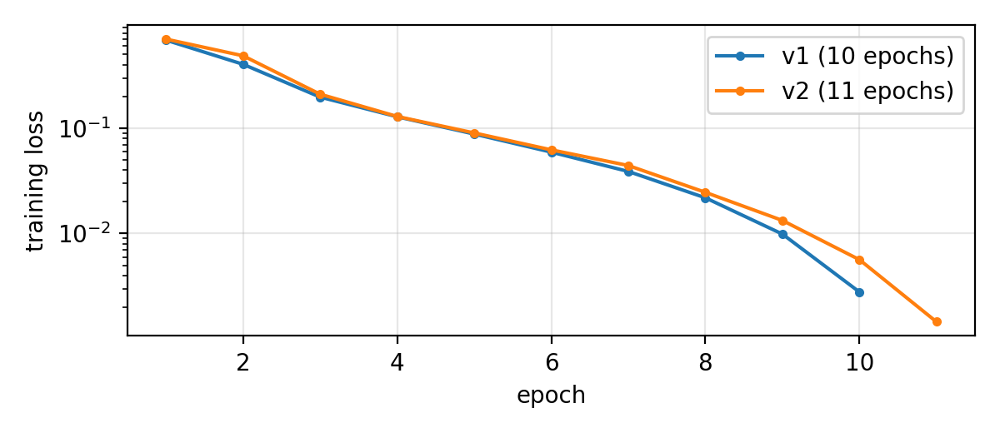

# Knowledge Distillation and Deployment of a Command Parser on a Local Cloud

Cloud Computing (CS3081) mini project. Repository: https://github.com/pardhu1502/cloud-kd
(assessed commit: tag `final`).

Every number in this report is **measured** and comes from a file in `results/` or `training/`
(named next to it). **Assumptions** are marked as such. All measurements were taken on one
Windows 11 laptop running Docker Desktop and a single-node k3d cluster.

## Architecture

```
 laptop                                   k3d cluster "kd" (single node)
 ------                                   -------------------------------------------------
 Ollama phi3.5  <-- host.k3d.internal --  pipeline: Job teacher-labelling (2 pods, shard 0/1)
                                                  |  write datasets/teacher/shard-i.jsonl
 clean.py, train.py  -- localhost:8333 -->  data: SeaweedFS (S3)  buckets: datasets, models
                                                  ^  download models/vN/ at start-up
 Locust  -- localhost:8080 --> Traefik --> app: Service parser --> Deployment parser (1-2 pods, HPA)
```

## Task 1: Object storage and parallel teacher labelling

**Setup.** Cluster from `cluster/k3d.yaml`; SeaweedFS (`k8s/data/seaweedfs.yaml`) runs master,
volume, filer and S3 gateway in one pod with a 5 GiB local-path volume. Buckets `datasets`
and `models` are created by `scripts/bootstrap_s3.py`. S3 keys are random per machine,
kept in the git-ignored `.env` and given to pods through Secrets.

**Teacher.** phi3.5 in Ollama on the laptop, `temperature 0`, `seed 42`, `format: json`
(constrained decoding; the reply text is stored unedited). Prompt: `prompts/teacher_prompt.txt`.

**Sharding.** The workers are one Kubernetes Indexed Job with `completions: 2` and
`parallelism: 2`. Kubernetes gives each pod a completion index (0, 1), which the manifest
passes in as `SHARD_INDEX`; `SHARD_COUNT` is 2. A worker keeps the commands whose line
number `n` (from 0) satisfies `n % SHARD_COUNT == SHARD_INDEX`. Because every `n` has exactly
one remainder, every command lands in exactly one shard, with no coordination between the
workers and no shared state; each worker writes only its own object
(`datasets/teacher/shard-<i>.jsonl`), so there are no write conflicts. Modulo instead of
contiguous blocks keeps the shards the same size and mixes easy and hard commands. Labelling
on a CPU takes hours, so each worker re-uploads its object every 25 records and skips ids
already present when it restarts; a pod failure therefore costs at most 25 teacher calls.
The bottleneck is the single Ollama instance, so more than two workers would not help much.

**Cleaning counts** (`results/clean_counts.json`):

| input | (a) invalid JSON | (b) wrong keys | (c) bad intent | (d) bad slot | duplicates | kept |
|---|---|---|---|---|---|---|
| 3000 | 0 | 2 | 12 | 169 | 47 | 2770 |

Checks run in the order (a) to (d); duplicates are counted among records that passed (a)-(d),
keeping the smallest id. `train.sha256`: `df78cd9a3131674eda3ee25319548902dca552510d5d7b6a7a46dda9b77318b4`
(re-running `clean.py` offline on `results/teacher/` gives the same hash). Both workers finished
1,500 records each in 116 minutes (about 0.22 replies/s per worker).

## Task 2: Training the student

Pythia-70M, full fine-tuning on CPU, first 1,500 records of `train.jsonl`. Example format
`Command: <text>\nJSON: <teacher JSON>` + EOS; loss only on the JSON tokens. Hyper-parameters
and library versions in `training/config.yaml`. v2 = one more epoch (`training/config_v2.yaml`).

Loss per epoch (`training/loss.csv`): 0.685, 0.404, 0.197, 0.128, 0.088, 0.059, 0.039, 0.022,
0.010, 0.003 (about 135 s per epoch on CPU). v2 (`training/loss_v2.csv`) ends at 0.0015 after 11 epochs.



Validation set, 100 commands (`results/*_validation.json`, scored with `tools/score.py`), all in %:

| model | json_validity | intent | date | time | place | full_frame |
|---|---|---|---|---|---|---|
| teacher phi3.5 | 99 | 86 | 76 | 84 | 91 | 50 |
| Pythia-70M untrained | 0 | 0 | 0 | 0 | 0 | 0 |
| student v1 | 98 | 82 | 79 | 85 | 84 | 44 |

**What changed.** The untrained Pythia-70M never produces a valid frame: given the same
`Command: ...\nJSON:` prompt it continues with fragments such as `{` or `- name: "calendar"`, so
every metric is 0. After distillation the same 70M model produces valid JSON for 98 of 100
commands and comes within a few points of the 3.8B teacher on every field. It is slightly
*better* than the teacher on date (79 vs 76) and time (85 vs 84), which is plausible because
it was trained on the cleaned replies only, so it never saw the teacher's malformed or
off-schema answers. It is worse on place (84 vs 91) and intent (82 vs 86), and full-frame
accuracy drops from 50 % to 44 %. The two invalid student outputs are a truncated/garbled
slot value and a frame with missing keys; the service turns these into HTTP 500s (Task 3).

Release asset `model-v1.tar.gz` SHA-256 = `models/v1/model.sha256` =
`2745c105d4355c022fdd29ac7ddc006e1502126761b33da88eb29c713031e4c4`
(v2: `cb3fb317a022883d27f2299537e25d0ee482350deccd3b9d09a0680ccb87891f`).

**Sequence-level vs logit-based distillation.**
(a) Sequence-level distillation trains the student with ordinary cross-entropy on the
*text the teacher generated*: the teacher's decoded output is used as the target sequence,
exactly like a human label (Kim and Rush, 2016).
(b) Logit-based (token-level) distillation trains the student to match the teacher's full
*probability distribution over the vocabulary at every position*, usually with a KL-divergence
loss on temperature-softened logits, so the student also learns which wrong tokens the teacher
found plausible.
(c) It is not possible here because the teacher and student do not share a tokenizer or
vocabulary (Phi-3.5 uses a 32k Llama-style vocabulary, Pythia a 50k GPT-NeoX one), so their
distributions are over different token sets and cannot be compared position by position; in
addition, Ollama only returns the generated text, not per-token logits over the vocabulary.
(d) Limitation: the student only ever sees the teacher's single greedy answer, including its
mistakes. Wherever phi3.5 is wrong (for example labelling a "remind me" request inconsistently,
or copying a longer phrase than the slot rules allow) the student learns the error as truth, and
the cleaning step only removes structurally invalid replies, not semantically wrong ones. The
student's accuracy is therefore capped by the teacher's: full-frame 44% for the student against
50% for phi3.5 on the same 100 commands.

## Task 3: Inference service

FastAPI (`service/app.py`), endpoints `/parse`, `/healthz`, `/readyz`; headers
`X-Model-Version` and `X-Served-By`; every output validated against `data/schema.json`
(500 `{"error": "invalid_model_output"}` otherwise; `FAULT_INJECT=1` forces it).
Image: `python:3.13.1-slim` + CPU-only PyTorch, all versions pinned, no weights (0 `.safetensors`
files in the image). Size: 1.71 GB unpacked, 369 MB compressed (`results/image_size.txt`).
50 sequential requests at 1 CPU / 1 GiB: 48 HTTP 200, 2 HTTP 500 (`invalid_model_output`, the
model's JSON failed the schema), not OOM-killed, peak memory 454.4 MiB (`results/mem_test.txt`).

## Task 4: Kubernetes deployment, scaling and reliability

Requests 500m / 512Mi, limits 1 CPU / 1 GiB; readiness `/readyz`, liveness `/healthz`;
`maxUnavailable 0`, `maxSurge 1`, `preStop sleep 5`. HPA 1-2 replicas at 70% CPU of the request.

| test | result | evidence |
|---|---|---|
| HPA 1 -> 2 -> 1 | load started 14:48:33; second replica requested by 14:49:00 (CPU 86% of request) and Ready by 14:49:10; load stopped 14:52:32, back to 1 replica by 14:54:01 | `results/hpa_test.txt` |
| rolling update v1 -> v2, failures | 6 of 298 = 2.0 %, all HTTP 500 `invalid_model_output`, no connection errors | `results/rollout_stats.csv`, `rollout_failures.csv` |
| X-Model-Version after undo | v2 after the update, v1 after `rollout undo` | `results/rollout_test.txt` |
| recovery: replicas restored, failures | 2/2 Ready again within 11 s; 4 of 208 = 1.9 %, all HTTP 500 `invalid_model_output` | `results/recovery_test.txt` |
| cold start (3 runs), median | 9.0 s (model download from S3 3.6-3.8 s) | `results/cold_start.txt` |
| load balancing per replica | 60 / 53 | `results/loadbalance_headers.json` |

Every failed request in these tests was a 500 from the schema check on the model's output (the
student's JSON validity is 98%), confirmed in the pod logs; none was caused by a pod going away.

**Limitations.** One laptop, one k3s node: replicas share one CPU and one failure domain, so
this shows recovery from a pod failure, not fault tolerance across machines. metrics-server
samples every ~15 s and the HPA acts on that, so short bursts are missed; both replicas also
compete for the same physical cores, so a second replica adds less capacity than on two machines.

## Task 5: Subnetting and NACL

Full working in `network/subnets.md`; the table is re-checked with Python's `ipaddress` in
`tests/test_network.py`. Subnets of 10.20.0.0/16 are allocated largest first, each with the
smallest prefix whose `2^(32-p) - 2` usable hosts covers the requirement.

| Subnet | Hosts needed | Network | Usable range | Broadcast | Usable hosts |
|---|---|---|---|---|---|
| app | 1,000 | 10.20.0.0/22 | 10.20.0.1 - 10.20.3.254 | 10.20.3.255 | 1,022 |
| public | 250 | 10.20.4.0/24 | 10.20.4.1 - 10.20.4.254 | 10.20.4.255 | 254 |
| data | 100 | 10.20.5.0/25 | 10.20.5.1 - 10.20.5.126 | 10.20.5.127 | 126 |
| management | 20 | 10.20.5.128/27 | 10.20.5.129 - 10.20.5.158 | 10.20.5.159 | 30 |

NACL for the public subnet (`network/nacl.json`). Inbound: 50 deny all from 198.51.100.0/24;
100 allow tcp 80 and 110 allow tcp 443 from anywhere; 120 allow tcp 22 from management
(10.20.5.128/27); 130 allow tcp 1024-65535 from app (10.20.0.0/22); default deny. Outbound:
100 allow tcp 8000 to app; 110 allow tcp 1024-65535 to anywhere; default deny.
`python tools/nacl_sim.py network/nacl.json network/packets_sample.jsonl --check`: **6/6**.

**Why separate reply rules, and why order matters.** A NACL is stateless: it does not remember
that a connection was opened, so every packet, replies included, is checked against the rules
on its own. When a client connects to port 443, the reply leaves the subnet towards the
client's ephemeral port (1024-65535), so it only gets out because outbound rule 110 allows
it; likewise the app's answer to the load balancer comes back to an ephemeral port and needs
inbound rule 130. A stateful security group would allow these replies automatically. Rules are
evaluated from the lowest number up and the first match wins: a packet from 198.51.100.9 to
port 443 matches both rule 50 (deny) and rule 110 (allow), and is blocked only because 50 is
lower. Numbered 200, the deny would never be reached for web traffic. A side effect of
statelessness: outbound rule 110 also lets the subnet open new connections to any port
from 1024 up (for example 8000 outside the app subnet), because a NACL cannot tell a reply from a
new connection.

## Task 6: Reproducibility and CI/CD

`make up` from a fresh clone (clone, cd, make up) creates the venv, the k3d cluster, random
S3 keys in the git-ignored `.env` and the matching Secrets, SeaweedFS, the buckets, both
images, downloads `model-v1`/`model-v2` from the GitHub Release into S3 (checking the
SHA-256), and deploys the app; `make down` deletes the cluster. (Each of these targets was
run on this laptop; a full `make up` on a second, clean machine was not tested.) All library versions are
pinned; training uses a fixed seed (42). CI (`.github/workflows/ci.yml`) runs, in order:
lint (ruff), unit tests (33 pytest tests: cleaning rules, shard coverage, service endpoints
and headers, fault injection, subnet plan and NACL), evaluation of the Release asset on
`validation.jsonl`, and the quality gate `score.py --min-validity 95`; gitleaks scans the
full history in parallel and reports nothing. Passing run with `model-v1`:
https://github.com/pardhu1502/cloud-kd/actions/runs/42490095335. Failed gate run with the
untrained model (`model_tag=bad`, JSON validity 0% < 95%):
https://github.com/pardhu1502/cloud-kd/actions/runs/42490284576.

## Task 7: Performance, cost and review

**Measured** (standard Locust run, 4 users, 2 minutes, `results/loadtest_*`): 128 requests,
p50 2,400 ms, p95 9,900 ms, max 12,792 ms, throughput 1.09 req/s, error rate 3.1 % (4 HTTP 500,
all `invalid_model_output`), per-pod CPU 575-1,000m (at the 1 CPU limit under load) and memory
451-473 Mi (`results/loadtest_top.txt`), cold start 9.0 s.

**Cost** (rate card: 3.50 INR per vCPU-hour, 0.45 INR per GiB-hour; billed on limits):

- one replica = 1 vCPU x 3.50 + 1 GiB x 0.45 = 3.95 INR/hour
- running replicas during the test = 2, so hourly cost = 2 x 3.95 = 7.90 INR/hour
- requests served per hour = 1.0867 x 3,600 = 3,912
- cost per 1,000 requests = 7.90 / 3,912 x 1,000 = 2.02 INR

**SLO.** 99% of `/parse` requests return HTTP 200 within 30 s, measured over one standard
load-test run (2 minutes). Error budget = 1% of 128 requests = 1.28 requests; used 4 failed
requests = 312 % of the budget, so the SLO was **not met** in this run. Latency was within the
target (slowest request 12.8 s < 30 s); all four failures were model outputs rejected by the
schema check, so the fix is model quality (a better student or constrained decoding), not
more replicas.

| Component | Evidence (measured) | Limitation | Improvement |
|---|---|---|---|
| Data and storage | 2,770 of 3,000 replies kept | single SeaweedFS pod, no replication | replicated volumes / erasure coding |
| Model quality | full-frame 44 % vs teacher 50 % | 70M model, teacher errors copied | larger student or logit KD with a shared tokenizer |
| Latency and throughput | p95 9,900 ms at 1.09 req/s | one request at a time per pod, CPU only | batching, quantised model, ONNX Runtime |
| Resource utilisation | up to 1,000m CPU, about 470 Mi per pod | CPU-bound, memory mostly idle | lower memory limit, more CPU per pod |
| Reliability and recovery | cold start 9.0 s, 1.9 % errors on pod loss (all model-output 500s) | single node | multi-node cluster, PodDisruptionBudget |
| Security and cost | 2.02 INR / 1,000 requests | plain HTTP, one S3 identity for everything | TLS on the Ingress, per-namespace read-only keys |

## References

Kim and Rush (2016); Chen et al. (2020); Bastianelli et al. (2020); Pythia-70M model card; k3d, SeaweedFS, Kubernetes documentation.
